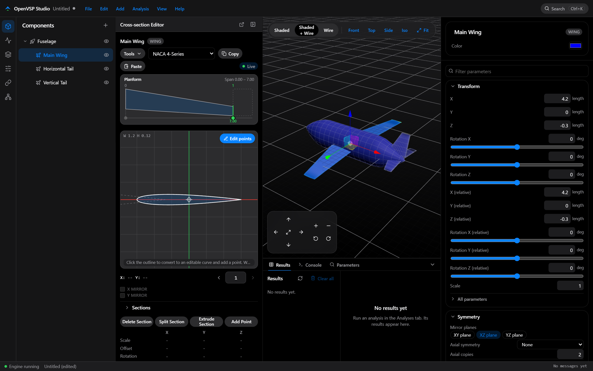
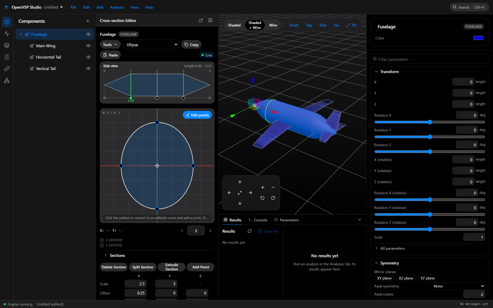
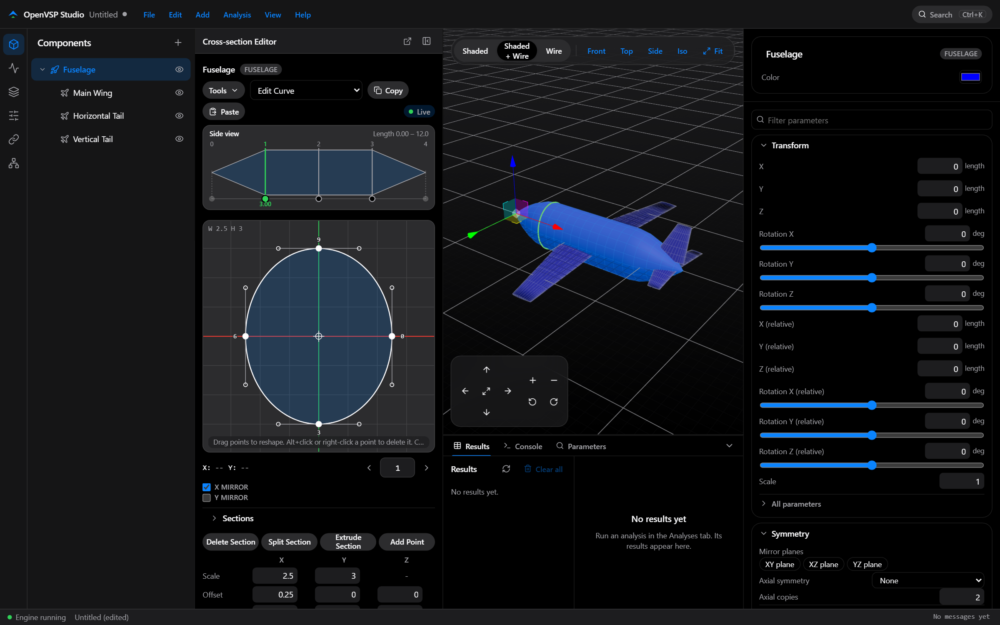
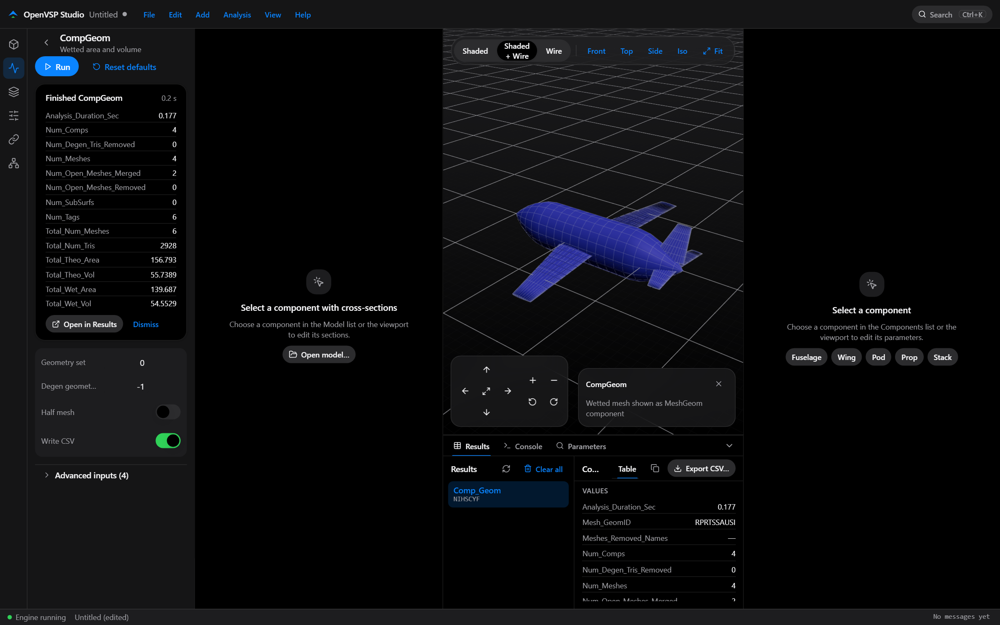
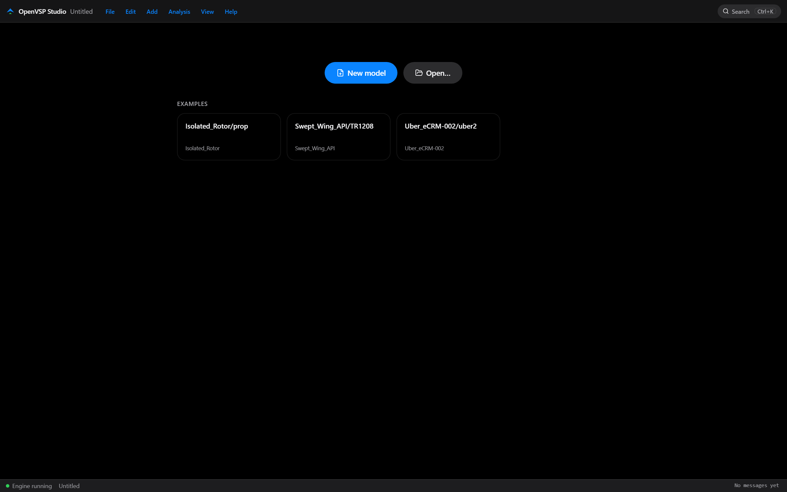

<div align="center">

# OpenVSP Studio

**A modern desktop front end for [OpenVSP](https://openvsp.org) 3.54, NASA's parametric aircraft geometry tool.**

Live 3D view · every parameter in one inspector · a Cross-Section Editor for fuselages, wings, stacks and props · all OpenVSP analyses



</div>

OpenVSP Studio keeps the full power of OpenVSP and puts it in one clean window. It does not replace the geometry kernel: every edit goes through the official OpenVSP Python API, so models saved here are ordinary `.vsp3` files that open in the stock `vsp.exe`.

## Quick start

Download an installer from the [Releases](https://github.com/Danf2873/OpenVSP-Studio/releases) page (Windows, macOS and Linux; OpenVSP is included), or run it from source:

```bash
git clone https://github.com/Danf2873/OpenVSP-Studio.git
cd OpenVSP-Studio
npm start
```

`npm start` launches the engine and the UI together and opens the app in your browser. It needs Python (same minor version as your OpenVSP build) and Node.js 20+; see [Developing](#developing) for the layout OpenVSP expects.

## A quick look

<table>
<tr>
<td width="50%"><br><sub><b>Edit any section.</b> Pick a section on the map, drag it along the body, or click between sections to add one.</sub></td>
<td width="50%"><br><sub><b>Sculpt freely.</b> Edit points turns a section into a curve you can reshape with handles, without changing it first.</sub></td>
</tr>
<tr>
<td width="50%"><br><sub><b>Analyse in place.</b> Run an analysis, read the results and export them to CSV from the same window.</sub></td>
<td width="50%"><br><sub><b>Start fast.</b> New model, open a file, or load a bundled VSPAERO example.</sub></td>
</tr>
</table>

## Highlights

- **Cross-Section Editor.** See every section of a component on one strip. Move sections, insert new ones anywhere, and turn any shape, airfoils included, into a freely editable curve without changing it.
- **Everything is reachable.** Forms are generated from OpenVSP's own parameter metadata, so every parameter has a control, and a searchable parameter explorer covers the rest.
- **Analyses on the model.** CompGeom, MassProp, VSPAERO, drag, CFD and FEA meshing and more, with results drawn on the 3D view while the analysis is open.
- **Undo and redo** for every edit, and a `Ctrl+K` command palette for actions, geometry types and parameters.
- **Dark and light themes**, native on Windows, macOS and Linux.

## Contents

- [Features](#features)
- [Installing](#installing)
- [Using the app](#using-the-app)
- [How it works](#how-it-works)
- [Repository layout](#repository-layout)
- [Developing](#developing)
- [Testing](#testing)
- [Building installers](#building-installers)
- [Troubleshooting](#troubleshooting)
- [OpenVSP API notes](#openvsp-api-notes)
- [License](#license)

---

## Features

### Modeling
- **Model tree** of all components. You can add, rename, copy, paste, cut, delete, reparent and show or hide components. The Add menu lists every OpenVSP geometry type, including custom `.vsppart` scripts.
- **3D viewport** (three.js), with three display modes: shaded, shaded + wireframe and wireframe.
  - Standard views (front, top, side, iso) and fit-to-view.
  - A move/scale gizmo and an on-screen pan/zoom/rotate pad.
  - Click a part in the view to select it.
- **Inspector** for the selected component, with curated fields first (transform, symmetry, design, attach) and then *All parameters*.
  - Every OpenVSP parameter is reachable, because forms are generated from parameter metadata. Parameters without a curated layout still get a working control.
- **Undo / redo** for every edit. A drag or a slider scrub counts as one undo step.
- **Command palette** (`Ctrl+K`) to search actions, geometry types, analyses and parameters by name.

### Cross-Section Editor
- **Section map**: a side view (bodies), planform (wings) or blade view (props) showing every section as a numbered line.
  - Click a line to edit that section.
  - Drag a line to move the section along the body.
  - Click between two sections to insert a new one there. On wings and stacks you can also click past the tip to extend them.
  - Inserted wing sections split the segment without changing the planform: span, chord and twist are interpolated.
- **Profile canvas**: a large 2D view of the selected section, with numbered points, red/green axes and a centre crosshair.
  - Drag the handles to resize parametric shapes.
  - **Edit points** turns any section, airfoils included, into an editable curve without changing its shape. Airfoils are refitted as a smooth cubic curve within 0.3% of their thickness.
  - Click the outline (or use Add Point) to add a point exactly where you click, without changing the shape.
  - Drag a point and its handles move with it. Delete a point with Alt+click or by right-clicking it.
  - X / Y mirror checkboxes.
- **Section controls**: shape picker (every `XS_*` type), copy/paste, Delete / Split / Extrude section, a section stepper, and a Scale / Offset / Rotation grid.
- **Airfoil library** browser for the `.dat` / `.af` files that ship with OpenVSP.
- The editor can be **popped out** into its own window. Selection stays in sync with the main window.

### Analyses and results
- All OpenVSP analyses (CompGeom, MassProp, VSPAERO sweeps and single points, Parasite Drag, Wave Drag, CpSlicer, Planar Slice, Projection, DegenGeom, CFD/FEA mesh, and more).
  - Input forms are generated from each analysis's inputs.
  - Long runs happen in the background with live progress.
- **3D result overlays** while an analysis is open:
  - VSPAERO: lift strips coloured by section lift coefficient, lift arrows and a free-stream arrow.
  - MassProp: centre-of-gravity markers.
  - CpSlicer: pressure curves.
  - The overlay clears when you leave the Analyses tab.
- **Results browser** with tables, X/Y plots and CSV export.

### Everything else
- **File**: New, Open, Save, Save As, Insert `.vsp3`, plus every OpenVSP import and export format (STL, OBJ, STEP, IGES, Cart3D, Plot3D, …).
- **Sets & visibility**: a components × sets membership grid.
- **Variables**: variable presets, design variables (`.des` / `.xddm`) and user parameters.
- **Advanced links**: inputs and outputs, an AngelScript code editor, and build errors shown inline.
- **Structures (FEA)**: structures, parts, subsurfaces, materials and properties.
- **Parameter explorer**: every container and parameter in the model, searchable.
- **Console**: a Python REPL running inside the engine (the `vsp` module is already imported), plus a runner for AngelScript files.
- Apple-style light and dark themes and a compact/comfortable density setting.

---

## Installing

Installers are attached to each [GitHub release](https://github.com/Danf2873/OpenVSP-Studio/releases). Each one includes OpenVSP 3.54, so you don't need to install OpenVSP separately.

| Platform | File | Notes |
|---|---|---|
| Windows x64 | `OpenVSP Studio_<ver>_x64_en-US.msi` | Includes its own Python 3.13 with NumPy. It also runs on Windows on ARM through emulation. |
| Windows ARM64 | `OpenVSP Studio_<ver>_arm64_en-US.msi` | Built by the release workflow. The app is native; the OpenVSP solvers run emulated. |
| macOS Apple Silicon | `OpenVSP Studio_<ver>_aarch64.dmg` | Includes a standalone Python 3.13. |
| macOS Intel | `OpenVSP Studio_<ver>_x64.dmg` | Includes a standalone Python 3.13. |
| Linux (Ubuntu 24.04) | `OpenVSP Studio_<ver>_amd64.deb` | Uses the system Python 3.12 (the OpenVSP Linux build links against it). |

- **Windows**: run the `.msi`. It installs for all users, so it asks for administrator rights.
- **macOS**: open the `.dmg` and drag the app to Applications.
  - The app is ad-hoc signed but not notarized. If macOS says it "is damaged", run this once:
    ```bash
    xattr -cr "/Applications/OpenVSP Studio.app"
    ```
- **Linux**: install the `.deb` with `apt`. That pulls in its dependencies, including `python3-numpy`, `libcminpack1`, `libxml2` and `libgomp1`:
  ```bash
  sudo apt install ./OpenVSP*_amd64.deb
  ```

The installed app writes solver output for unsaved models to a temporary folder (`%TEMP%\OpenVSP Studio` or the platform equivalent), because the install location is read-only.

---

## Using the app

1. **Start**: choose **New model** or **Open…**, or pick a recent file or a bundled example (`vspaero_ex`) on the welcome screen.
2. **Add components** from the Add menu, the `+` in the Components list, or the command palette.
3. **Edit** the selected component in the Inspector (right). Use the gizmo in the 3D view to move or scale it.
4. **Shape it** in the Cross-Section Editor (left, toggled from the View menu):
   - pick a section on the section map;
   - change its shape type or size, or press **Edit points** to sculpt it freely;
   - drag sections along the body, or click the map to add new ones.
5. **Analyse** from the Analyses tab: set inputs and press **Run**. Results appear on the model while the tab is open and stay in the Results dock afterwards.
6. **Save** as `.vsp3` or export to another format from the File menu.

Keyboard shortcuts:

| Keys | Action |
|---|---|
| `Ctrl+K` | Command palette |
| `Ctrl+N` / `Ctrl+O` | New / Open |
| `Ctrl+S` / `Ctrl+Shift+S` | Save / Save As |
| `Ctrl+Z` / `Ctrl+Y` (or `Ctrl+Shift+Z`) | Undo / Redo |
| `Ctrl+C` / `Ctrl+X` / `Ctrl+V` | Copy / Cut / Paste component |
| `Delete` | Delete the selected component |
| `F` | Fit the 3D view |

In the profile canvas, hold `Shift` to snap while dragging, use the mouse wheel to zoom, and double-click to fit the view.

---

## How it works

OpenVSP's geometry kernel is C++, and the only stable way into it from outside is its Python API. So the app is three layers:

```
┌──────────────────────────────┐
│ UI (React + three.js)        │  ui/
│ panes, 3D view, editors      │
└──────────────┬───────────────┘
               │ invoke("vsp_call") / events     (or WebSocket in browser dev mode)
┌──────────────▼───────────────┐
│ Rust shell (Tauri 2)         │  src-tauri/
│ window, dialogs, settings,   │
│ spawns + supervises engine   │
└──────────────┬───────────────┘
               │ newline-delimited JSON-RPC over stdin/stdout
┌──────────────▼───────────────┐
│ Python engine                │  engine/
│ owns the OpenVSP model,      │
│ calls `import openvsp`       │
└──────────────────────────────┘
```

- **Engine** (`engine/vsp_engine.py`, handlers in `engine/api/*.py`)
  - A single long-lived process owns the model.
  - Methods register with `@method("ns.name", mutates=…, long=…, concurrent=…)` in `engine/registry.py`.
    - `mutates`: takes an undo snapshot and emits `model_changed`. Calls that share a `coalesceKey` merge into one undo step.
    - `long`: replies with `{jobId}` straight away and emits `job_done` later.
    - `concurrent`: the method only reads files, so it runs outside the model lock (used for live solver progress).
  - The OpenVSP API is not thread-safe, so every `vsp` call runs on one worker thread under `VSP_LOCK`.
  - OpenVSP prints to stdout, which would corrupt the protocol. So the engine keeps a private copy of file descriptor 1 for the protocol and redirects the real stdout to stderr. The Rust shell shows stderr in the Console pane.
- **Generic parameter engine**: every OpenVSP feature is a *Parm* in a container.
  - `engine/parmutil.py` turns parms into JSON, and `engine/parmmeta.py` adds friendly labels, units and enum names.
  - Unknown parms still render with a default control. That's how every feature stays reachable without a hand-built form per geometry type.
- **Rust shell**
  - Spawns the engine with the right Python and OpenVSP paths, restarts it if it crashes, and forwards its events to the UI.
  - Tauri commands: `vsp_call`, `engine_restart`, `engine_status`, `get_settings`, `set_settings`, `open_window`.
  - Events: `engine://event`, `engine://log` and `engine://status`.
- **RPC contract**: [`docs/API.md`](docs/API.md) is the source of truth for every method's name, parameters and result shape.

---

## Repository layout

```
openvsp_gui/
├── engine/                 Python RPC engine
│   ├── vsp_engine.py       stdio / WebSocket server, dispatcher, worker thread
│   ├── registry.py         @method registry, undo snapshots, coalescing
│   ├── vspctx.py           finds the OpenVSP install and imports `openvsp`
│   ├── state.py            model tree / ModelState JSON
│   ├── parmutil.py         Parm + ParmGroup JSON
│   ├── parmmeta.py         curated labels, units, enums
│   ├── api/                one module per RPC namespace
│   │   ├── app.py          app info, ping, native file dialog (browser mode)
│   │   ├── model.py        new/open/save/insert, undo/redo, components
│   │   ├── parms.py        parameter get/set, explorer
│   │   ├── mesh.py         tessellation for the 3D view, section rings
│   │   ├── xsec.py         sections: shapes, edit curves, airfoils
│   │   ├── xsec_layout.py  section map: positions, move, insert anywhere
│   │   ├── analysis.py     analyses and results
│   │   ├── overlay.py      3D analysis overlays (VSPAERO, MassProp, CpSlicer)
│   │   ├── io.py           import / export
│   │   ├── sets.py  vars.py  links.py  fea.py  subsurf.py  console.py
│   └── tests/              pytest suite
├── src-tauri/              Rust shell (Tauri 2)
│   ├── src/lib.rs          commands, window setup
│   ├── src/engine.rs       engine process supervision
│   ├── src/settings.rs     settings + locating bundled OpenVSP / Python
│   ├── tauri.conf.json     app + Windows MSI config
│   ├── tauri.macos.conf.json   macOS .app / .dmg overrides
│   └── tauri.linux.conf.json   Linux .deb overrides (deps, no bundled Python)
├── ui/                     React 18 + TypeScript + Vite
│   └── src/
│       ├── api/            RPC client (Tauri invoke or WebSocket), typed wrappers
│       ├── store/          zustand stores (model, UI, parms, overlays)
│       ├── layout/         app shell, toolbar, menus, panes registry, shortcuts
│       ├── components/     buttons, fields, sliders, modals, …
│       ├── features/       one folder per pane (xsec-editor, viewport, analyses, …)
│       └── styles/tokens.css   all colours and design tokens (light + dark)
├── tools/stage_bundle.py   assembles bundle/ for the installers
├── docs/API.md             engine ↔ UI RPC contract
└── .github/workflows/release.yml   CI build for Windows, macOS and Linux
```

---

## Developing

### Prerequisites

- **OpenVSP 3.54** for your platform. The repo is designed to sit inside an OpenVSP install: `openvsp_gui/` is a child of the OpenVSP root folder, the one holding `vsp(.exe)` and `python/openvsp/`. The engine finds the root on its own. To use a different location, set `OPENVSP_ROOT`.
- **Python** with the same minor version as the OpenVSP Python module (3.13 for the Windows and macOS builds, 3.12 for the Ubuntu build), plus `numpy`, `six`, and `pytest` for the tests. For browser mode you also need `fastapi` and `uvicorn`.
- **Node.js** 20+ and npm.
- **Rust** (stable) plus the [Tauri 2 prerequisites](https://v2.tauri.app/start/prerequisites/) for your OS: MSVC Build Tools and WebView2 on Windows, Xcode Command Line Tools on macOS, `webkit2gtk-4.1` and friends on Linux.

You don't need to `pip install` the OpenVSP Python packages. `engine/vspctx.py` adds `python/openvsp`, `python/degen_geom` and `python/utilities` to `sys.path` itself.

### Install dependencies

```bash
npm install
npm --prefix ui install
```

### Run the desktop app

```bash
npm run dev
```

This starts the Vite dev server and the Tauri window, and the Rust shell spawns the engine. On Windows, if `cargo` isn't on your `PATH`, add it first: `export PATH="$HOME/.cargo/bin:$PATH"`.

### Run in a plain browser (no Rust needed)

```bash
npm start
```

This starts the engine (`ws://127.0.0.1:8765/ws`) and the UI together and opens <http://localhost:5173>. Press `Ctrl+C` to stop both. Use `PYTHON=python3.13 npm start` to pick a specific interpreter, or `npm start -- --no-open` to skip opening the browser.

To run the two halves yourself, use `python engine/vsp_engine.py --ws 8765` and `npm --prefix ui run dev`. When `window.__TAURI__` is missing, the UI talks to the engine over the WebSocket, and file dialogs open natively through the engine.

### Conventions

- **API changes**: update [`docs/API.md`](docs/API.md) whenever you add or change an RPC method.
- **Colours**: use the CSS variables in `ui/src/styles/tokens.css`; never hard-code colours elsewhere. This check should return nothing:
  ```bash
  grep -rE "#[0-9a-fA-F]{3,6}" ui/src --include=*.tsx
  ```
- **Engine output**: never print to the engine's protocol stream. Use `logging` or stderr.
- **New panes**: add them in `ui/src/layout/registry.tsx`.

---

## Testing

```bash
python -m pytest engine/tests -q
```

To run a single test:

```bash
python -m pytest engine/tests/test_xsec.py::test_fuselage_list_and_get -q
```

To typecheck the UI:

```bash
npm --prefix ui run typecheck
```

To check the Rust shell compiles:

```bash
cargo check --manifest-path src-tauri/Cargo.toml
```

The engine suite (about 76 tests) covers the model, parameters, meshing, sections and edit curves, the section map, analyses and results, file I/O, sets, variables, links, FEA, subsurfaces and the analysis overlays. Each test starts from a fresh model.

---

## Building installers

The installers ship two folders as resources, both staged by `tools/stage_bundle.py`:

- `bundle/openvsp/`: the OpenVSP solvers and executables, the OpenVSP Python API, airfoils, examples, help, plus a copy of `engine/`.
- `bundle/python/`: a private Python with NumPy and six.
  - Windows: the embeddable CPython zip from python.org.
  - macOS: a [python-build-standalone](https://github.com/astral-sh/python-build-standalone) build.
  - Linux: none; it uses the system `python3`.

`stage_bundle.py` finishes by starting the bundled engine and pinging it, so a broken bundle fails the build.

### Windows (local)

The embeddable zip must match your Python version. For example, with Python 3.13.14, put `python-3.13.14-embed-amd64.zip` in `build_cache/`. Then:

```bash
python tools/stage_bundle.py
```

```bash
npm run build
```

```bash
npx tauri build --target x86_64-pc-windows-msvc
```

The `npm run build` installer is for your machine's architecture and lands in `src-tauri/target/release/bundle/msi/`. The `x86_64` target build lands in `src-tauri/target/x86_64-pc-windows-msvc/release/bundle/msi/`. `npm run dist` stages and builds in one step.

### macOS / Linux (local)

Point the script at an extracted OpenVSP 3.54 distribution. On macOS, also pass a python-build-standalone `*-install_only.tar.gz` for Python 3.13:

```bash
python3 tools/stage_bundle.py --vsp-root /path/to/OpenVSP-3.54.0-MacOS --python-archive cpython-3.13.x-aarch64-apple-darwin-install_only.tar.gz
```

On Linux, the OpenVSP `.deb` installs to `/opt/OpenVSP`. Make sure `python3-numpy` and `python3-six` are installed first.

```bash
python3 tools/stage_bundle.py --vsp-root /opt/OpenVSP
```

Then build on either platform:

```bash
npx tauri build
```

### GitHub Actions (all platforms)

[`.github/workflows/release.yml`](.github/workflows/release.yml) builds the Windows x64 and ARM64 MSIs, the macOS Apple Silicon and Intel DMGs, and the Linux `.deb`, then attaches them to a GitHub release. Each job:

1. downloads the official OpenVSP 3.54.0 build for its platform from openvsp.org;
2. downloads the matching Python;
3. runs `stage_bundle.py`, including the engine smoke test;
4. builds with `tauri-action` and uploads the installers.

To publish a release, push a version tag:

```bash
git tag v0.1.0
```

```bash
git push origin v0.1.0
```

You can also start it by hand from the Actions tab (**Release → Run workflow**). The release is named after the tag; when started by hand it uses the version in `package.json`.

---

## Troubleshooting

| Symptom | Fix |
|---|---|
| "Connecting to engine…" never finishes | Check the Console pane or the engine's stderr. Usually the Python version doesn't match the OpenVSP module, or `numpy` is missing. In Settings, set the Python path and OpenVSP root by hand. |
| `import openvsp` fails with a missing `degen_geom` | `python/degen_geom` must be on the path. `vspctx.py` adds it, so make sure `OPENVSP_ROOT` points at the real root. |
| VSPAERO runs but nothing shows on the model | Keep the Analyses tab open on that analysis; overlays only show while it's open. Unsaved models write solver files to the temp folder. |
| Linux: `libcminpack.so.1` or `libpython3.12.so` not found | Install the `.deb` with `apt` (not `dpkg -i`) so its dependencies come along, or run `sudo apt -f install`. |
| macOS: "app is damaged" | Run `xattr -cr "/Applications/OpenVSP Studio.app"`. The build is not notarized. |
| Staging fails with "Access is denied" on Windows | OneDrive or antivirus locked a file in `bundle/`. Run the script again; it retries locked deletes. |

---

## OpenVSP API notes

These quirks of the 3.54 Python API are handled by the engine. They're worth knowing before you add features:

- **Section points**: `ComputeXSecPnt` returns section-local points. `GetXSecSurfGlobalXForm` leaves out the component transform, so 3D section rings are sampled from the tessellation instead.
- **Inserting and deleting sections**:
  - `InsertXSec(geom, i, type)` inserts *after* `i`.
  - There is no `DeleteXSec`; use `CutXSec`.
  - On wings, `InsertXSec` appends instead of splitting the segment, and can overwrite neighbouring sections. `xsec.insertAt` saves and restores the planform itself.
- **Wing chords are linked**: a section's `Root_Chord` is the previous section's `Tip_Chord`.
- **Converting to an edit curve**:
  - `ChangeXSecShape(…, XS_EDIT_CURVE)` keeps fuselage shapes but resets airfoils.
  - `ConvertXSecToEdit` rebuilds the whole component, so don't use it.
- **Edit-curve points**:
  - `GetEditXSecCtrlVec(xs, True)` returns points scaled to unit size (divided by width/height).
  - `CurveType` values: 0 = linear, 1 = PCHIP, 2 = cubic Bézier (anchor, handle, handle, anchor…).
  - `EditXSecSplit01` adds a point without changing the shape. It is ignored on the mirrored half of a symmetric curve, and when `u` is already a point.
- **Where parameters live**:
  - Wing planform parameters (Span, Root_Chord, Sweep, …) are in each section's XSec container.
  - A root component's `X_Location` is derived; edit `X_Rel_Location` instead.
  - `Sym_Planar_Flag` bits: XY = 1, XZ = 2, YZ = 4.
- **VSPAERO** needs `VSPAEROComputeGeometry` before `VSPAEROSweep`, and writes its files next to the model file.
- **Errors** don't raise exceptions. Read them from `vsp.ErrorMgrSingleton.getInstance()`.

---

## License

OpenVSP is released by NASA under the [NASA Open Source Agreement](https://github.com/OpenVSP/OpenVSP/blob/main/LICENSE). The installers redistribute the official OpenVSP 3.54.0 binaries unchanged, with their license file.

OpenVSP Studio is an independent project. It is not affiliated with or endorsed by NASA or the OpenVSP team.
